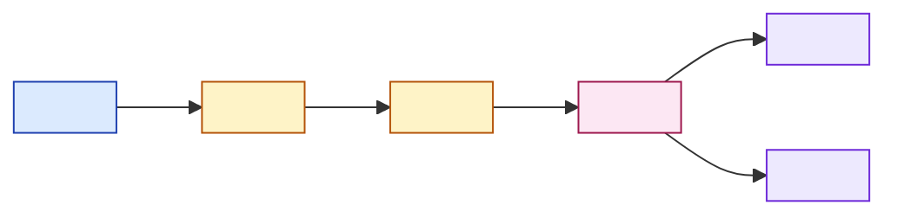

## Template | Método Operacional

`Modelo canônico para documentação e registro de métodos operacionais.`

---

| Status            | *[X] proposto* [ ] vigente [ ] obsoleto |
| ----------------- | --------------------------------------- |
| **Responsável**   | Núcleo de Dados – OITS-UFS              |
| **Atualizado em** | 10/10/2026                              |
| **Versão**        | v0.1                                    |

---

```markdown
# Método <NN>: <Título do Método>

---

| Status            | *[X] proposto* [ ] vigente [ ] obsoleto |
| ----------------- | --------------------------------------- |
| **Responsável**   | `<institucional>`                       |
| **Atualizado em** | `<data>`                                |
| **Versão**        | `<versao>`                              |

---

## 1. Objetivo

 <Descrever o propósito do método: qual problema resolve, por que a formalização (e, quando aplicável, a automação) é necessária, e qual etapa da metodologia ele operacionaliza.>

---

## 2. Escopo

**O método cobre:**

1. <Item>
2. <Item>
3. <Item>b

**O método não cobre:**

- <Item, com referência ao documento/seção onde o tema é tratado — ex.: "Critérios de elegibilidade (`00_metodologia.md – Seção 2.2`)".>

---

## 3. Entradas

| Campo          | Descrição   | Formato   | Origem                       |
| -------------- | ----------- | --------- | ---------------------------- |
| <nome_entrada> | <descrição> | <formato> | <caminho ou etapa de origem> |
|                |             |           |                              |

---

## 4. Saídas

| Campo        | Descrição   | Formato   | Destino                       |
| ------------ | ----------- | --------- | ----------------------------- |
| <nome_saida> | <descrição> | <formato> | <caminho ou etapa de destino> |
|              |             |           |                               |

---

## 5. Processo



---

| Etapa                  | Descrição                               |
| ---------------------- | --------------------------------------- |
| **<Etapa 1>**          | <descrição objetiva do que a etapa faz> |
| **<Etapa 2>**          | <descrição>                             |
| **<Etapa 3>**          | <descrição>                             |
| **<Etapa de decisão>** | <descrição>                             |

---

## 6. Regras de Operação

| Regra | Descrição                                          |
| ----- | -------------------------------------------------- |
| R1    | <regra — preferencialmente verificável e testável> |
| R2    | <regra>                                            |
| R3    | <regra>                                            |

---

## 7. Registro de <unidade principal, ex.: recurso>

| Campo   | Tipo   | Origem               |
| ------- | ------ | -------------------- |
| <campo> | <tipo> | <etapa que o produz> |
|         |        |                      |

---

## Registro do lote

| Campo   | Tipo   |
| ------- | ------ |
| <campo> | <tipo> |
|         |        |

---

## Registro de exceção/exclusão *(quando aplicável)*

| Campo   | Tipo   |
| ------- | ------ |
| <campo> | <tipo> |
|         |        |

---

## Síntese

| Registro         | Escopo                                  | Chave   | Finalidade   |
| ---------------- | --------------------------------------- | ------- | ------------ |
| **<Registro 1>** | <por item / por execução / por exceção> | <chave> | <finalidade> |
| **<Registro 2>** |                                         | <chave> |              |

---

## **Registro de Alterações**

| Versão   | Data   | Alteração   | Autor   |
| -------- | ------ | ----------- | ------- |
| <versão> | <data> | <alteração> | <autor> |

---
```

## **Registro de Alterações**

| Versão | Data       | Alteração                                    | Autor        |
| ------ | ---------- | -------------------------------------------- | ------------ |
| v0.1   | 10/10/2026 | Criação do *template* de Método Operacional. | Nayara Pavao |

---
